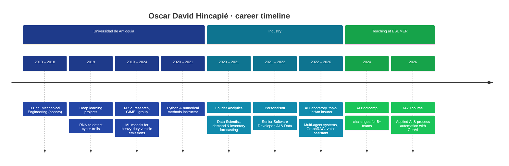

  
  
  
  

  
  
  
  

I've spent **9 years** applying machine learning, deep learning and generative AI: first as a researcher modeling vehicle emissions, then building production systems for insurance, finance and retail. Today I design **multi-agent systems, RAG pipelines and LLM-powered automation** on Google Cloud and Azure.

> 🇪🇸 Ingeniero de IA con 9 años en ML, deep learning e IA generativa. Diseño sistemas multiagente, RAG y automatización con LLMs en GCP y Azure.

- 🔭 **Building now:** an AI suite for e-commerce: cited-answer RAG, returns agents, document extraction and fraud detection ([see below](#-portfolio-ai-for-e-commerce))
- 🧑‍🏫 **Teaching:** applied AI and process automation with generative AI at ESUMER
- 🌱 **Exploring:** agent evaluation, voice agents and computer vision for retail
- 💬 **Ask me about:** RAG that doesn't hallucinate, multi-agent design, taking AI prototypes to production
- ⚡ **Fun fact:** before LLMs, I trained models to predict what comes out of a truck's exhaust pipe

## 🧭 Journey at a glance

## 🗂️ My career, moment by moment

Four moments, each with its own question. Public repositories are linked; work done for employers and clients stays private.

### 🎓 Moment 1 · Foundations (2013 – 2019)
**How does a mechanical engineer end up in AI?** I studied Mechanical Engineering at Universidad de Antioquia (graduated with honors), where engines, sensors and noisy measurements taught me to respect data. In 2019 I took my first deep learning courses and built my first neural networks, including an RNN that detects cyber-trolls in tweets.

📂 [ProyectoU3](https://github.com/NarciH/ProyectoU3) · [ProyectoU4](https://github.com/NarciH/ProyectoU4) &nbsp;   

### 🔬 Moment 2 · Research (2019 – 2024)
**Can machine learning predict what comes out of a truck's exhaust?** My M.Sc. at Universidad de Antioquia (GIMEL group) answered that with ML models trained on real driving data from heavy-duty vehicles. The work produced a thesis and 3 peer-reviewed papers, including one in *Environmental Pollution* (2020).

📂 [Thesis manuscript](https://github.com/NarciH/memory_work_master) &nbsp;   

### 🧑‍🏫 Moment 3 · Teaching (2020 – today)
**How do you make AI click for people who are just starting?** I've taught Python and numerical methods to engineering students at Universidad de Antioquia, designed the challenges of ESUMER's AI Bootcamp, and in 2026 I teach IA20, a 15-week course on applied AI and process automation with generative AI.

📂 [PyMed-2020-1](https://github.com/NarciH/PyMed-2020-1) · [PyMed-2021-1](https://github.com/NarciH/PyMed-2021-1) · [reto-esumer](https://github.com/NarciH/reto-esumer) · [template-reto-tecnico-estudIA](https://github.com/NarciH/template-reto-tecnico-estudIA) &nbsp;   

### 🏢 Moment 4 · AI in production (2020 – 2026)
**What does it take for AI to work inside a real company?** Six years building AI for retail, finance and insurance: demand forecasting at Fourier Analytics, NLP and risk models at Personalsoft, and multi-agent systems, RAG and voice assistants at the AI Laboratory of a large Latin American insurer. That's where I learned that monitoring, governance and the people who use the system matter as much as the model.

🔒 Private work for employers and clients &nbsp;    

## 🚀 Portfolio: AI for e-commerce
A four-part portfolio around **Mercado Aurora**, a fictional online store:

| Project | What it does | Built with | Try it |
|---|---|---|---|
| [Policy assistant (RAG)](cases/ecommerce-ia-rag.md) | Customer-service chatbot that answers return, shipping and warranty questions **with exact citations**, and abstains instead of inventing | Gemini · Google Cloud | [Live demo](https://ecrag-frontend-4y6shrzafa-uc.a.run.app) |
| [Returns agents](cases/ecommerce-ia-agentes.md) | AI agents that process a return end-to-end, with **human approval** before any risky refund | Google ADK · Gemini | Coming soon |
| [Document extractor](cases/ecommerce-ia-extractor-llm.md) | Fine-tuned small LLM that turns invoices and return requests into **validated JSON** | Fine-tuned open LLM (QLoRA) · Gemini | In progress |
| [Fraud detection with MLOps](cases/ecommerce-ia-fraude-mlops.md) | Payment and return fraud scores that **explain each decision**; expected fraud cost cut from 1,725 to 676 EUR per 1,000 payments on test data | Gradient boosting · explainable AI | Coming soon |

Each project page explains the problem, what the solution does and the measured results. Source code is private; I'm happy to show any of them working in a call.

<b>Fraud detection demo, measured on test data</b> (<a href="cases/ecommerce-ia-fraude-mlops.md">details</a>)

<table>
  <tr>
    <td align="center" width="25%"><h2>64%</h2>of payment fraud caught while sending only 1.7% of payments to review</td>
    <td align="center" width="25%"><h2>-61%</h2>expected fraud cost per 1,000 payments</td>
    <td align="center" width="25%"><h2>88%</h2>of return abuse caught</td>
    <td align="center" width="25%"><h2>-73%</h2>expected cost per 1,000 returns</td>
  </tr>
</table>

## 🧰 Toolbox

  

  
  
  
  
  
  
  
  

<b>Full list</b>

**AI / ML:** multi-agent systems, RAG, GraphRAG, LLMs (GPT, Gemini), fine-tuning (QLoRA), deep learning, NLP · Google ADK, MCP, LangChain, Semantic Kernel, Azure AI Agent Framework
**Google Cloud:** Vertex AI, Vector Search, BigQuery, Document AI, Cloud Run, GKE, AlloyDB
**Azure:** AI Foundry, Azure OpenAI, AI Search, Machine Learning, Databricks, Data Factory, Document Intelligence
**Languages & data:** Python, R, SQL, C/C++, MATLAB · PostgreSQL, MongoDB · CI/CD, Vertex AI and Azure ML pipelines · UiPath, Power Platform

## 📈 Activity

  

<picture>
  <source media="(prefers-color-scheme: dark)" srcset="https://raw.githubusercontent.com/NarciH/NarciH/output/github-contribution-grid-snake-dark.svg" />
  <source media="(prefers-color-scheme: light)" srcset="https://raw.githubusercontent.com/NarciH/NarciH/output/github-contribution-grid-snake.svg" />
  
</picture>

## 🤝 Let's work together
I take on short freelance projects: chatbots and RAG over your documents, AI agents that automate workflows, and taking AI prototypes to production.

  

