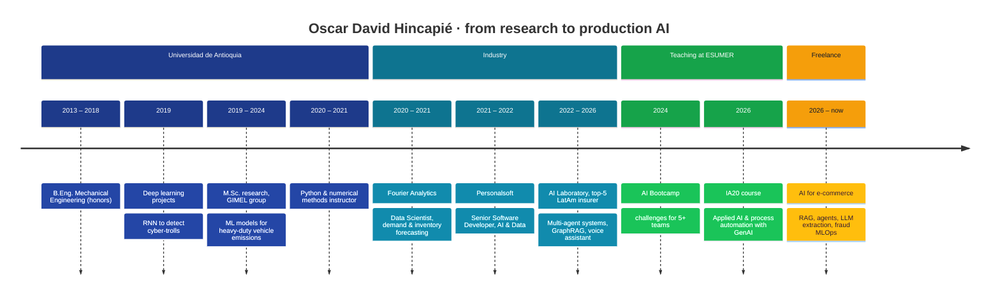

  
  
  
  

  
  
  

I've spent **9 years** applying machine learning, deep learning and generative AI: first as a researcher modeling vehicle emissions, then building production systems for insurance, finance and retail. Today I design **multi-agent systems, RAG pipelines and LLM-powered automation** on Google Cloud and Azure.

> 🇪🇸 Ingeniero de IA con 9 años en ML, deep learning e IA generativa. Diseño sistemas multiagente, RAG y automatización con LLMs en GCP y Azure.

<table>
  <tr>
    <td align="center" width="25%"><h2>53%</h2>of health-policy management automated with multi-agent systems</td>
    <td align="center" width="25%"><h2>-40%</h2>physician time on AI-assisted medical opinions (GraphRAG)</td>
    <td align="center" width="25%"><h2>~60%</h2>of monthly requests moved to AI-assisted handling (NLP + RPA)</td>
    <td align="center" width="25%"><h2>-61%</h2>expected fraud cost per 1,000 payments in my fraud-detection demo</td>
  </tr>
</table>

## 🧭 Journey at a glance

## 🗂️ Repository traceability: where each piece of work comes from

Every stage of my career, the organization behind it and the public work you can open. Client and employer code is private, so those stages show results instead of links.

| When | Organization · role | What I built | Public work | Tech |
|:---:|---|---|---|---|
| **2026 – now** | **Freelance** · AI Engineer | Four-part AI suite for *Mercado Aurora*, a fictional online store: cited-answer RAG, returns agents, document extraction, fraud detection | [Case studies](#-building-now-ai-for-e-commerce) · [▶ Live demo](https://ecrag-frontend-4y6shrzafa-uc.a.run.app) |    |
| **2026** | **ESUMER** · Instructor, IA20 | 15-week course on applied AI and process automation with generative AI: ML, LLMs, RAG, agents, n8n, spec-driven development, 7 applied projects | Course material (private, students' work) |    |
| **2022 – 2026** | **AI Laboratory, top-5 Latin American insurer** · Digital Automation Specialist | Multi-agent systems that automated **53%** of health-policy management · GraphRAG and multimodal RAG (**-40%** physician time) · voice-to-voice RAG assistant · monitoring of 10+ automations · AI governance adopted by 10+ teams | Private (employer) |    |
| **2024** | **ESUMER** · AI Bootcamp | Designed the bootcamp challenge (tweet classification with RNN/LSTM) and the common template for 5+ teams solving real company problems | [reto-esumer](https://github.com/NarciH/reto-esumer) · [template-reto-tecnico-estudIA](https://github.com/NarciH/template-reto-tecnico-estudIA) |   |
| **2021 – 2022** | **Personalsoft** · Senior Software Developer, AI & Data | ML/DL for investment-risk inference · transformer NLP + RPA that moved **~60%** of monthly requests to AI-assisted handling | Private (client) |    |
| **2020 – 2021** | **Fourier Analytics** · Data Scientist | Demand and inventory forecasting for a major apparel brand | Private (client) |   |
| **2020 – 2021** | **Universidad de Antioquia** · Python instructor | Structured programming and numerical methods workshops for engineering students | [PyMed-2020-1](https://github.com/NarciH/PyMed-2020-1) · [PyMed-2021-1](https://github.com/NarciH/PyMed-2021-1) |   |
| **2019 – 2024** | **Universidad de Antioquia, GIMEL group** · M.Sc. researcher | Machine-learning models to predict pollutant emissions from heavy-duty vehicles · 3 peer-reviewed papers, including *Environmental Pollution* (2020) | [Thesis manuscript](https://github.com/NarciH/memory_work_master) |   |
| **2019** | **Universidad de Antioquia** · Deep learning coursework | Deep learning project and an RNN that detects cyber-trolls | [ProyectoU3](https://github.com/NarciH/ProyectoU3) · [ProyectoU4](https://github.com/NarciH/ProyectoU4) |  |
| **2013 – 2018** | **Universidad de Antioquia** · B.Eng. Mechanical Engineering | Graduated with honors | | |

## 🚀 Building now: AI for e-commerce
A four-part portfolio around **Mercado Aurora**, a fictional online store:

| Project | What it does | Built with | Try it |
|---|---|---|---|
| [Policy assistant (RAG)](cases/ecommerce-ia-rag.md) | Customer-service chatbot that answers return, shipping and warranty questions **with exact citations**, and abstains instead of inventing | Gemini · Google Cloud | [Live demo](https://ecrag-frontend-4y6shrzafa-uc.a.run.app) |
| [Returns agents](cases/ecommerce-ia-agentes.md) | AI agents that process a return end-to-end, with **human approval** before any risky refund | Google ADK · Gemini | Coming soon |
| [Document extractor](cases/ecommerce-ia-extractor-llm.md) | Fine-tuned small LLM that turns invoices and return requests into **validated JSON** | Fine-tuned open LLM (QLoRA) · Gemini | In progress |
| [Fraud detection with MLOps](cases/ecommerce-ia-fraude-mlops.md) | Payment and return fraud scores that **explain each decision**; expected fraud cost cut from 1,725 to 676 EUR per 1,000 payments on test data | Gradient boosting · explainable AI | Coming soon |

Each project page explains the problem, what the solution does and the measured results. Source code is private; I'm happy to show any of them working in a call.

## 🧰 Toolbox

  
  
  
  
  
  
  
  
  
  
  
  
  
  

**AI / ML:** multi-agent systems, RAG, GraphRAG, LLMs (GPT, Gemini), fine-tuning (QLoRA), deep learning, NLP · Google ADK, MCP, LangChain, Semantic Kernel, Azure AI Agent Framework
**Google Cloud:** Vertex AI, Vector Search, BigQuery, Document AI, Cloud Run, GKE, AlloyDB
**Azure:** AI Foundry, Azure OpenAI, AI Search, Machine Learning, Databricks, Data Factory, Document Intelligence
**Languages & data:** Python, R, SQL, C/C++, MATLAB · PostgreSQL, MongoDB · CI/CD, Vertex AI and Azure ML pipelines · UiPath, Power Platform

## 🤝 Let's work together
I take on short freelance projects: chatbots and RAG over your documents, AI agents that automate workflows, and taking AI prototypes to production.

  

