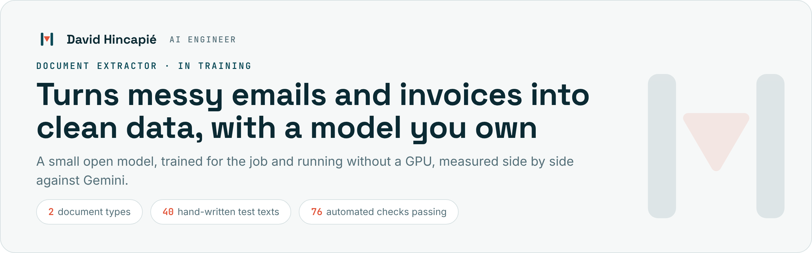

  <picture>
    <source media="(prefers-color-scheme: dark)" srcset="../assets/cases/ecommerce-ia-extractor-llm-dark.png">
    
  </picture>

# A small fine-tuned model that turns emails and invoices into clean data

**Status: built and tested; the first training run is next, then it goes live and is compared with Gemini.**

## The problem

Return requests arrive as messy emails ("hi, the trainers from last Monday's order are too small…") and invoices as free text. Someone has to copy the order number, dates, amounts and reasons into a system. A large hosted model can do it, but you pay per document and your data leaves your control. The question: **can a small open model, trained for the job and running on an ordinary server without a GPU, match it?**

## What it does

- Reads a **return request** and fills in customer, order, delivery date (also from "last Monday"), product, reason, condition, amount, a one-line summary and urgency.
- Reads an **invoice** and fills in number, seller and tax id, every line with quantity and discount, base, VAT and total.
- Always returns a complete, valid record or a clear error, never a half-filled one. Missing data stays empty instead of being invented.

## What your business gets

| Without it | With the extractor |
|---|---|
| People retype order numbers, dates and amounts | A structured record per document, ready for your system |
| A large model billed per document, with your data outside | A small model you own, in your own cloud |
| Invented values when the text is unclear | Empty fields when the data is missing |

## How it is measured

- **Same task, three models**: the fine-tuned small model, the same model without training, and Gemini, all with the same instructions.
- **An honest test**: 40 texts written by hand, plus a test set locked before training.
- **What gets reported**: accuracy per field, invoice lines found, valid records, full matches, response time and cost per 1,000 documents.

## Results

Accuracy, response time and cost against Gemini will be published here once the comparison has run. This page only publishes measured numbers.

## Where it fits

Return requests, complaints and supplier invoices in e-commerce; claim emails, delivery notes and forms in insurance and logistics; any team copying data from text into a system.

**Built with** an open 4-billion-parameter model fine-tuned for the task, compared with Gemini.

---

*The source code is private. Happy to show it working on a call.* · [David Hincapié](https://github.com/NarciH), AI engineer · [← All projects](../README.md)
