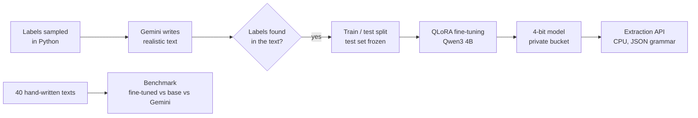

# A small fine-tuned model that turns emails and invoices into validated JSON

**Status: in progress.** The pipeline is built and tested; the first training run and the benchmark against Gemini come next.

## The problem

Return requests arrive as messy emails ("hi, the trainers from last Monday's order are too small…") and invoices as free text. Someone has to copy the order number, dates, amounts and reasons into a system. A large hosted model can do it, but at a cost per document and with your data leaving your control. The question this project answers: **can a small open model, fine-tuned for the job and run on a plain CPU, match it?**

## What it does

- Extracts a **return request** (customer, order, delivery date, product, reason, condition, amount, a one-line summary, urgency) or an **invoice** (number, seller and tax id, lines with quantities and discounts, base, VAT, total) into JSON that always validates.
- Never returns a half-filled object: output is constrained to the JSON Schema while it is generated, and validated again before it is returned.

## How it works

- **Labels exact by construction**: Python samples the answer first and Gemini only writes the text around it; a validator rejects any text that does not contain its labels.
- **An honest test set**: 40 texts written by hand, plus a generated test split frozen by hash, so training refuses to start if the test data changed.
- **Same prompt for every model**, and metrics per field: dates and amounts normalized, invoice-line F1, valid-JSON rate and full exact match, plus latency and cost per document.

## Engineering

| Area | Choice |
|---|---|
| Model | Qwen3 4B Instruct, QLoRA, served as a 4-bit GGUF with llama.cpp on CPU |
| Data | Synthetic generation with Gemini on Vertex AI, run from CI with keyless authentication |
| Service | FastAPI with JSON-schema-constrained decoding |
| Quality | 70 automated tests, about 94 % coverage, with a fake model |

## Results

Accuracy, latency and cost against Gemini will be published here once the benchmark has run. This page will only publish measured numbers.

*Source code is private. Happy to walk through it in a call.*
