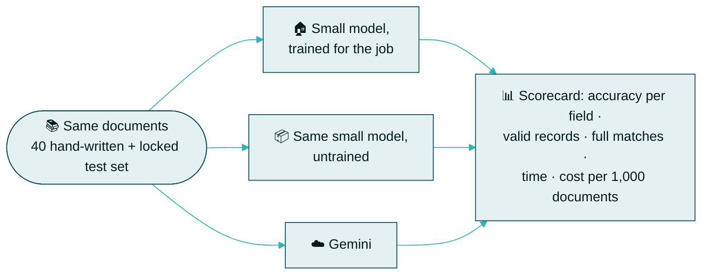

<a id="top"></a>
<div align="center">


<p>
  
  
  
</p>

<a href="#-whats-next"></a>

</div>

> [!NOTE]
> **Status:** built and tested. The first training run is next; then it goes live and is compared with Gemini.

## 😣 The problem

Return requests arrive as messy emails and invoices as free text. Someone has to **copy the order number, dates, amounts and reasons into a system**, by hand.

A large hosted model can do it, but you pay per document and your data leaves your control. The question this project answers: **can a small open model, trained for the job and running on an ordinary server without a GPU, match it?**

## 🧭 From messy text to clean data

<p align="center"></p>

## 🔍 Before and after

<table>
  <tr>
    <th width="50%">📩 What arrives</th>
    <th width="50%">✅ What your system gets</th>
  </tr>
  <tr>
    <td valign="top">

*"Hola, las zapatillas del pedido del lunes pasado me quedaron pequeñas, ¿puedo cambiarlas? Pedido MA-48213."*

<sub>Illustrative example.</sub>

</td>
    <td valign="top">

```json
{
  "cliente": null,
  "pedido_id": "MA-48213",
  "fecha_entrega": "2026-11-16",
  "producto": "zapatillas",
  "departamento": "moda",
  "motivo": "talla",
  "importe": null,
  "descripcion_breve": "Pide cambiar unas zapatillas pequeñas.",
  "urgente": false
}
```

</td>
  </tr>
</table>

*"Last Monday"* becomes a real date. The amount and the customer's name weren't in the email, so they stay **empty**, not invented.

## 🧩 What's inside

<table>
  <tr>
    <td valign="top" width="33%"><h3>📩 Return requests</h3>Customer, order, delivery date (even from <i>"last Monday"</i>), product, reason, condition, amount, a one-line summary and urgency.</td>
    <td valign="top" width="33%"><h3>🧾 Invoices</h3>Number, seller and tax id, every line with quantity and discount, base, VAT and total.</td>
    <td valign="top" width="33%"><h3>✅ Always a valid record</h3>A complete, valid record or a clear error, never a half-filled one.</td>
  </tr>
  <tr>
    <td valign="top" width="33%"><h3>🙅 No invented values</h3>Missing data stays empty instead of being guessed.</td>
    <td valign="top" width="33%"><h3>🏠 A model you own</h3>A small open model, trained for this job, running on your own server without a GPU.</td>
    <td valign="top" width="33%"><h3>⚖️ Measured against Gemini</h3>Same task, same instructions, side by side, so the choice is made on numbers.</td>
  </tr>
</table>

## 🔀 How it is measured



## 💼 What your business gets

| | Without it | With the extractor |
|:-:|---|---|
| ⌨️ | People retype order numbers, dates and amounts | A structured record per document, ready for your system |
| 💸 | A large model billed per document, with your data outside | A small model you own, in your own cloud |
| 🎲 | Invented values when the text is unclear | Empty fields when the data is missing |

## 📊 Results

> [!NOTE]
> Accuracy, response time and cost against Gemini will be published here, dated, once the comparison has run. This page only publishes measured numbers.

## 🌍 Where it fits

<table>
  <tr>
    <td valign="top" width="33%"><h3>🛒 E-commerce</h3>Return requests, complaints and supplier invoices.</td>
    <td valign="top" width="33%"><h3>🛡️ Insurance</h3>Claim emails and forms.</td>
    <td valign="top" width="33%"><h3>🚚 Logistics</h3>Delivery notes and any text someone copies into a system.</td>
  </tr>
</table>

## 🧰 Built with

<p align="center">
  
  
  
  
  
  
</p>

<details>
<summary><b>📖 Key ideas in plain words</b></summary>

- **Fine-tuning:** taking a general open model and training it further on examples of one job, so a small model does that job well.
- **Structured output:** the answer is a record with fixed fields your system can store directly, not free text.
- **Validation:** every record is checked against the expected fields and types before it leaves.
- **Locked test set:** examples set aside before training, so the scores are honest.

</details>

<details>
<summary><b>❓ Questions a client usually asks</b></summary>

- **Can it read my documents?** Yes, with examples of your own documents it learns your fields and wording.
- **Does my data leave my company?** With the small model, no: it runs on your own server.
- **Is it better than a big model?** That is exactly what the comparison will show, with numbers.

</details>

## 🧭 What's next

- [x] Extraction for return requests and invoices, with validation
- [x] Hand-written and locked test sets
- [ ] First training run and comparison with Gemini
- [ ] Live demo

## 🤝 Want this on your own data?

I build this kind of system for real businesses, on your documents, your orders and your cloud. The source code is private; **I'm happy to show it working on a call** and talk about what it would take for your team.

<p align="center">
  <a href="https://linkedin.com/in/odavidhg"></a>
  <a href="../README.md"></a>
</p>

### More from the portfolio

<table>
  <tr>
    <td align="center" width="25%"><a href="ecommerce-ia-rag.md"><b>📚<br/>Policy assistant</b></a><br/><sub>Answers with the exact clause</sub></td>
    <td align="center" width="25%"><a href="ecommerce-ia-fraude-mlops.md"><b>🛡️<br/>Fraud & return-abuse detection</b></a><br/><sub>Scores, explains, reviews less</sub></td>
    <td align="center" width="25%"><a href="ecommerce-ia-agentes.md"><b>🤖<br/>Returns agents</b></a><br/><sub>Closes simple returns, asks on risky ones</sub></td>
    <td align="center" width="25%"><a href="ecommerce-ia-vision.md"><b>🎥<br/>In-store video analytics</b></a><br/><sub>Counts, dwell time, queues, answers</sub></td>
  </tr>
</table>

<div align="center">

<picture>
  <source media="(prefers-color-scheme: dark)" srcset="../assets/brand/logo-horizontal-dark.svg" />
  
</picture>

<sub><b>Mercado Aurora</b> is a fictional store with synthetic data, created for these demos. · <a href="#top">Back to top ↑</a></sub>


</div>
