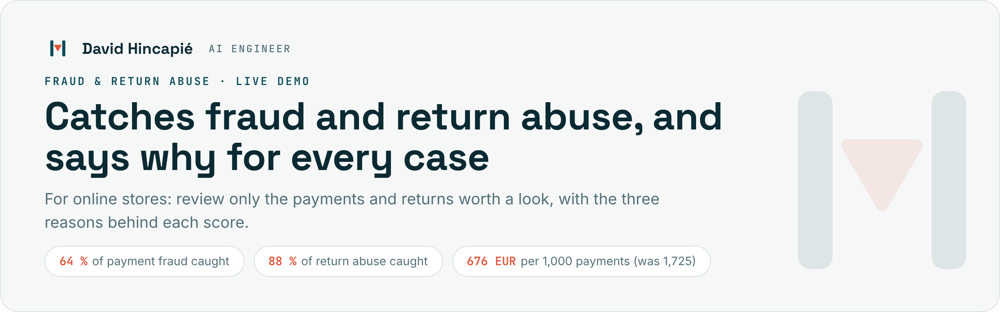

  <a href="https://ecfraud-api-4y6shrzafa-uc.a.run.app">
  <picture>
    <source media="(prefers-color-scheme: dark)" srcset="../assets/cases/ecommerce-ia-fraude-mlops-dark.png">
    
  </picture>
  </a>

# Fraud and return-abuse detection that explains every decision

**[▶ Try the live demo](https://ecfraud-api-4y6shrzafa-uc.a.run.app)** · no sign-up; the first request after a quiet period can take up to ~30 s while the service wakes up.

## The problem

An online store loses money twice: to stolen cards and fraud rings at checkout, and to return abuse afterwards (a dress worn for the weekend and sent back, a parcel that "never arrived"). Blocking too much loses good customers; reviewing everything by hand costs too much. The team needs a score it can act on, and a reason it can trust.

## What it does

- Scores every **payment** and every **return**, and gives the **three reasons** that pushed the score the most. Example: a 1,899 EUR electronics order from an account opened yesterday, shipping to an address four other accounts used this month, scores 0.99, and the first reason is "accounts at the same address".
- Draws the line between "let it through" and "send to review" from **money, not accuracy**: the cost of a manual review against the cost of a missed case.
- Learns again with new data and **only replaces the current model when the new one is better**.

## What your business gets

| Without it | With the fraud detector |
|---|---|
| Rules of thumb that block good customers or let rings through | A score per payment and return, tuned to what each mistake costs |
| Analysts guess why an order looks odd | Every score names its top three reasons |
| Reviewing everything, or nothing | Only the cases worth a review reach a person |

## Try it in the demo

Choose **Pago** (payment) or **Devolución** (return), click an example such as *Red de cuentas nuevas* (a ring of new accounts) or *Vestido tras el fin de semana* (a dress returned after the weekend), press **Evaluar** and read the **Por qué** (why) panel.

## Results

Measured on 2026-11-20 on a year of simulated activity (about 80,000 orders plus a Black Friday month). Test set: the last ~7 weeks, which the model never saw.

| | Payments | Returns |
|---|--:|--:|
| Events in the test set | 12,000 (1.15 % fraud) | 1,556 (4.8 % abuse) |
| Share sent to manual review | **1.7 %** | **14 %** |
| Fraud or abuse caught | **64 %** | **88 %** |
| Expected cost per 1,000 events (no model → model) | 1,725 → **676 EUR** | 2,853 → **775 EUR** |

Return abuse is never caught at 80 % precision, so returns stay a review queue, not an automatic block.

## Where it fits

E-commerce and marketplaces, insurance and lending review queues, and any team that must decide where its review hours go.

**Built with** gradient-boosted trees and per-decision explanations, on Google Cloud. **Mercado Aurora** is a fictional store created for this demo.

---

*The source code is private. Happy to show it working on a call.* · [David Hincapié](https://github.com/NarciH), AI engineer · [← All projects](../README.md)
