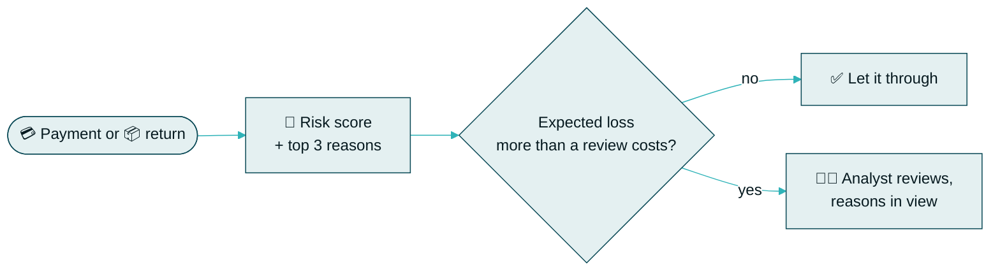
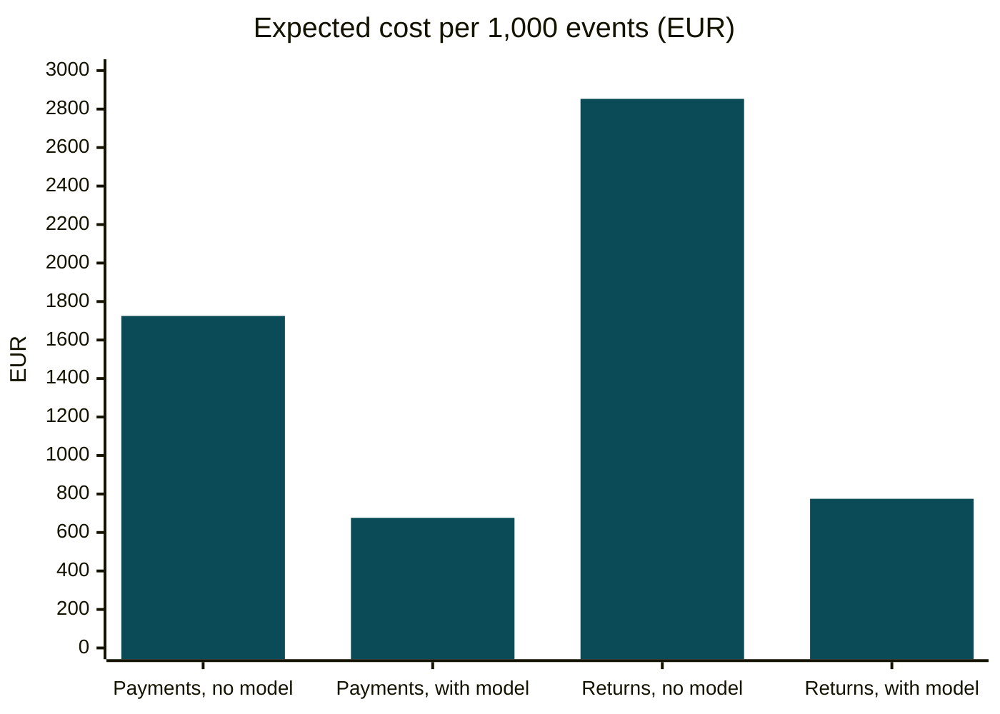

  
  
  
  

## 😣 The problem

An online store loses money twice:

- 💳 **At checkout:** stolen cards and rings of new accounts.
- 📦 **After delivery:** return abuse, like a dress worn for the weekend and sent back, or a parcel that "never arrived".

Blocking too much loses good customers; reviewing everything by hand costs too much. The team needs **a score it can act on, and a reason it can trust**.

## 🧭 What happens to every order

> [!TIP]
> The demo sleeps when nobody uses it, so the first request after a quiet period can take up to ~30 s. Everything after that is fast.

## 🧩 What's inside

<table>
  <tr>
    <td valign="top" width="33%"><h3>🎯 One score per event</h3>Every <b>payment</b> and every <b>return</b> gets a risk score from 0 to 1 the moment it arrives.</td>
    <td valign="top" width="33%"><h3>💬 The three reasons why</h3>Each score names what pushed it most, e.g. <i>"accounts at the same address"</i>. Analysts stop guessing.</td>
    <td valign="top" width="33%"><h3>💶 A line drawn by money</h3>The cut-off between <i>let it through</i> and <i>review</i> comes from the cost of a review versus the cost of a missed case, not from accuracy.</td>
  </tr>
  <tr>
    <td valign="top" width="33%"><h3>🔁 Learns, carefully</h3>It retrains on new data and <b>only replaces the current model when the new one is better</b>.</td>
    <td valign="top" width="33%"><h3>🕵️ Two kinds of abuse</h3>Separate scoring for checkout fraud and for return abuse, because they behave differently.</td>
    <td valign="top" width="33%"><h3>📈 Ready for peaks</h3>Tested on a year of activity that includes a Black Friday month.</td>
  </tr>
</table>

## 🔀 How a decision is made

**Example from the demo:** a 1,899 EUR electronics order from an account opened yesterday, shipping to an address four other accounts used this month, scores **0.99**. The first reason: *accounts at the same address*.

## 💼 What your business gets

| | Without it | With the fraud detector |
|:-:|---|---|
| 🚧 | Rules of thumb that block good customers or let rings through | A score per payment and return, tuned to what each mistake costs |
| ❓ | Analysts guess why an order looks odd | Every score names its top three reasons |
| ⚖️ | Reviewing everything, or nothing | Only the cases worth a review reach a person |
| 🧪 | A new model goes live on hope | A new model replaces the old one only when it measures better |

## 🧪 Try it in 60 seconds

1. Open the **[live demo](https://ecfraud-api-4y6shrzafa-uc.a.run.app)**.
2. Choose **Pago** (payment) or **Devolución** (return).
3. Click an example, press **Evaluar** and read the **Por qué** (why) panel.

| Example | What to look for |
|---|---|
| *Red de cuentas nuevas* (a ring of new accounts) | A score near 1 and "same address" among the reasons |
| *Vestido tras el fin de semana* (dress returned after the weekend) | Return abuse flagged, with the reasons behind it |

## 📊 Results

<b>Measured on 2026-11-20 on ~7 weeks of activity the model never saw</b>

<table>
  <tr>
    <td align="center" width="25%"><h2>64%</h2>of payment fraud caught</td>
    <td align="center" width="25%"><h2>1.7%</h2>of payments sent to review</td>
    <td align="center" width="25%"><h2>88%</h2>of return abuse caught</td>
    <td align="center" width="25%"><h2>-73%</h2>expected cost per 1,000 returns</td>
  </tr>
</table>

| | 💳 Payments | 📦 Returns |
|---|--:|--:|
| Events in the test set | 12,000 (1.15% fraud) | 1,556 (4.8% abuse) |
| Share sent to manual review | **1.7%** | **14%** |
| Fraud or abuse caught | **64%** | **88%** |
| Expected cost per 1,000 events (no model → model) | 1,725 → **676 EUR** | 2,853 → **775 EUR** |

Data: a year of simulated activity (about 80,000 orders plus a Black Friday month). Return abuse is never caught at 80% precision, so returns stay **a review queue, not an automatic block**.

## 🌍 Where it fits

<table>
  <tr>
    <td valign="top" width="33%"><h3>🛒 E-commerce & marketplaces</h3>Checkout fraud, promo abuse and return abuse.</td>
    <td valign="top" width="33%"><h3>🏦 Insurance & lending</h3>Claims and applications that need a ranked review queue.</td>
    <td valign="top" width="33%"><h3>🧑‍💼 Any review team</h3>Wherever people must decide where their review hours go.</td>
  </tr>
</table>

## 🧰 Built with

  
  
  
  
  
  

<b>📖 Key ideas in plain words</b>

- **Risk score:** a number from 0 to 1 that says how likely an event is to be fraud or abuse.
- **Explanations per decision:** for each score, the factors that pushed it up or down the most, in plain words.
- **Cost-based threshold:** instead of chasing accuracy, the line is set where the money lost to missed fraud and the money spent on reviews add up to the least.
- **MLOps:** the routine that retrains, compares and promotes models safely, so the system keeps up with new fraud patterns.

<b>❓ Questions a client usually asks</b>

- **Does it block customers automatically?** It doesn't have to. You decide what happens above the line: block, hold or review. Returns, in particular, stay a review queue.
- **Can it use my own data?** Yes; the demo uses synthetic data from a fictional store, and the same process trains on your history.
- **What if fraud patterns change?** It retrains on new data and only promotes a model that measures better.

## 🧭 What's next

- [x] Live demo with payment and return scoring
- [x] Cost-based thresholds measured on unseen weeks
- [ ] Monitoring dashboard for drift over time
- [ ] Short walkthrough video

## 🤝 Want this on your own data?

I build this kind of system for real businesses, on your documents, your orders and your cloud. The source code is private; **I'm happy to show it working on a call** and talk about what it would take for your team.

  
  

### More from the portfolio

<table>
  <tr>
    <td align="center" width="25%"><a href="ecommerce-ia-rag.md"><b>📚 Policy assistant</b></a> Answers with the exact clause</td>
    <td align="center" width="25%"><a href="ecommerce-ia-agentes.md"><b>🤖 Returns agents</b></a> Closes simple returns, asks on risky ones</td>
    <td align="center" width="25%"><a href="ecommerce-ia-vision.md"><b>🎥 In-store video analytics</b></a> Counts, dwell time, queues, answers</td>
    <td align="center" width="25%"><a href="ecommerce-ia-extractor-llm.md"><b>🧾 Document extractor</b></a> Messy text to clean records</td>
  </tr>
</table>

<picture>
  <source media="(prefers-color-scheme: dark)" srcset="../assets/brand/logo-horizontal-dark.svg" />
  
</picture>

<b>Mercado Aurora</b> is a fictional store with synthetic data, created for these demos. · <a href="#top">Back to top ↑</a>

