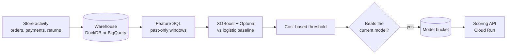

# Fraud and return-abuse detection that explains every decision

**Live demo: coming soon** (the deployment is ready and waiting for its first release).

## The problem

An online store loses money twice: to stolen cards and fraud rings at checkout, and to return abuse afterwards (wearing a dress for the weekend and returning it, or claiming a parcel "never arrived"). Blocking too much loses good customers; reviewing everything by hand is too expensive. The team needs a score they can act on, and a reason they can trust.

**Mercado Aurora** is a fictional online store (electronics, home, fashion). The project generates a year of realistic activity, about 80,000 orders, plus a drifted Black Friday month, with documented fraud and abuse patterns.

## What it does

- Scores **payments** and **returns** with two models and returns, for every score, the **three factors that pushed it the most**. Example: a 1,899 EUR electronics order from an account opened yesterday, shipping to an address four other accounts used this month, scores 0.99 with "accounts at the same address" as the top factor.
- Chooses each decision threshold from **money, not accuracy**: the cost of a manual review against the cost of a missed case.
- Retrains on every release and **only replaces the current model if the new one is better** by a fixed margin.

## How it works

- **Features in SQL** that run unchanged on DuckDB locally and BigQuery in the cloud. Every window looks only at the past; a test inserts future events and checks that past features do not move.
- **Explanations** come from the model itself (exact SHAP contributions), so the service needs no extra library.
- **The same features online and offline**: the API computes them in Python, and a test feeds 200 events through both paths and requires identical values.

## Results (measured on the synthetic data, test set = the last ~7 weeks)

| | Payments | Returns |
|---|---|---|
| Events in the test set | 12,000 (1.15 % fraud) | 1,556 (4.8 % abuse) |
| Share sent to manual review | 1.7 % | 14 % |
| Fraud or abuse caught | 64 % | 88 % |
| Expected cost per 1,000 events | 1,725 → **676 EUR** | 2,853 → **775 EUR** |

On payments XGBoost ties the logistic baseline on PR-AUC (0.556) but is better at the top of the ranking, which is where reviewers work (recall at 80 % precision 0.63 vs 0.57). On returns it gains 0.09 PR-AUC (0.529 vs 0.438), because abuse depends on combinations a linear model cannot express. Return abuse is never caught at 80 % precision, so it stays a review queue, not an automatic block.

## Engineering

| Area | Choice |
|---|---|
| Models | XGBoost tuned with Optuna, logistic regression baseline, temporal split |
| Service | FastAPI on Cloud Run, scaling to zero; public demo page rate-limited per IP |
| Data | DuckDB locally, BigQuery in the cloud, same SQL templates |
| Infrastructure | Terraform: model bucket, least-privilege service account, API key in Secret Manager |
| Delivery | GitHub Actions: tests, type checks, secret scanning and an end-to-end training run on every change; keyless deploy (Workload Identity Federation) that retrains and promotes the champion |
| Quality | 50 automated tests, about 96 % coverage; the whole pipeline runs in about 25 s without a cloud account |

*Source code is private. Happy to walk through it in a call.*
