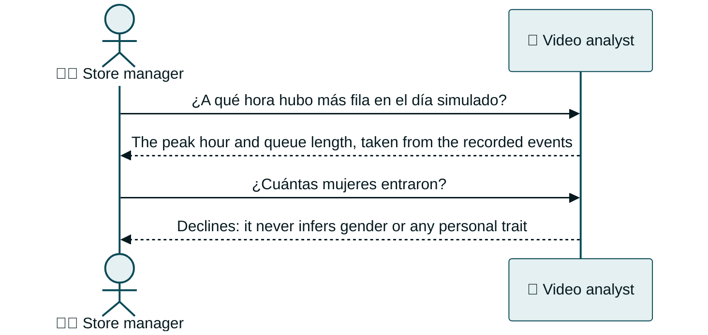

  
  
  
  

## 😣 The problem

A physical store already has cameras, but **nobody watches the footage**. The questions a manager actually has go unanswered:

> *How many people came in today? · Which areas hold their attention? · When does the checkout line get too long? · Did staffing match the busy hours?*

## 🧭 From cameras to answers

> [!TIP]
> The demo sleeps when nobody uses it, so the first request after a quiet period can take up to ~30 s. Everything after that is fast.

## 🧩 What's inside

<table>
  <tr>
    <td valign="top" width="33%"><h3>🚪 People counting</h3>Entries and exits, hour by hour, from ordinary store video.</td>
    <td valign="top" width="33%"><h3>⏱️ Dwell time per zone</h3>How long visitors stay at the entrance, in each aisle and at checkout.</td>
    <td valign="top" width="33%"><h3>🚨 Queue alerts</h3>Flags the checkout line when it passes a threshold you choose.</td>
  </tr>
  <tr>
    <td valign="top" width="33%"><h3>💬 Ask the analyst</h3>Questions in plain Spanish; every number in the answer comes from the recorded events, never made up.</td>
    <td valign="top" width="33%"><h3>🙈 Private by design</h3>Faces blurred, uploads deleted after a day, and it never guesses age, gender or any personal trait.</td>
    <td valign="top" width="33%"><h3>🖥️ No special hardware</h3>Processes video on ordinary servers, without GPUs.</td>
  </tr>
</table>

## 🔀 A conversation with the analyst

## 💼 What your business gets

| | Without it | With the video analytics |
|:-:|---|---|
| 📼 | Footage nobody watches | Entries, exits, dwell time and queue alerts from the same cameras |
| 🎲 | Staffing by gut feeling | Busy hours and queue peaks, per day |
| 😟 | Worries about filming customers | Blurred faces, short retention, no personal traits inferred |
| 📊 | Reports someone has to build | Ask a question, get the number and where it came from |

## 🧪 Try it in 60 seconds

1. Open the **[live demo](https://ecvision-frontend-4y6shrzafa-uc.a.run.app)**.
2. In **Ver resultados**, pick the `entrada-01` clip, then `cajas-01` for the queue chart.
3. In **Pregúntale al analista**, try the questions below.

| Ask this | What to look for |
|---|---|
| ¿A qué hora hubo más fila en el día simulado? | The peak hour, with the figure behind it |
| The `cajas-01` clip | The checkout queue over time, and when it crossed the alert line |
| ¿Cuántas mujeres entraron? | A polite refusal: it never infers gender |

## 📊 Results

> [!NOTE]
> Counting error, detection accuracy, processing speed and the share of questions answered correctly are being measured on labeled sample footage. They will appear here, dated, once measured. This page only publishes measured numbers.

## 🌍 Where it fits

<table>
  <tr>
    <td valign="top" width="33%"><h3>🛍️ Stores and supermarkets</h3>Traffic, dwell time and checkout staffing.</td>
    <td valign="top" width="33%"><h3>🏦 Banks and service counters</h3>Waiting times and peak hours at each counter.</td>
    <td valign="top" width="33%"><h3>🏛️ Malls, museums, events</h3>Visitor flow without identifying anyone.</td>
  </tr>
</table>

## 🧰 Built with

  
  
  
  
  
  

<b>📖 Key ideas in plain words</b>

- **Computer vision:** software that finds and follows people in video frames, so they can be counted and timed.
- **Zones:** areas you draw on the camera image (entrance, aisle, checkout) to measure where time is spent.
- **Grounded answers:** the assistant reads only the recorded events, so every number it gives can be traced.
- **Privacy by design:** blurring, short retention and a hard "no" to personal traits are built in, not optional.

<b>❓ Questions a client usually asks</b>

- **Do I need new cameras?** No; it works on ordinary store video.
- **Does it recognise people?** No. It counts and times anonymous visitors and blurs faces.
- **Can it run on my premises?** It runs on ordinary servers without GPUs, in the cloud or on-site.

## 🧭 What's next

- [x] Live demo with counting, dwell time, queues and the analyst
- [ ] Publish counting error, accuracy and speed on labeled footage
- [ ] Short walkthrough video with sample clips

## 🤝 Want this on your own data?

I build this kind of system for real businesses, on your documents, your orders and your cloud. The source code is private; **I'm happy to show it working on a call** and talk about what it would take for your team.

  
  

### More from the portfolio

<table>
  <tr>
    <td align="center" width="25%"><a href="ecommerce-ia-rag.md"><b>📚 Policy assistant</b></a> Answers with the exact clause</td>
    <td align="center" width="25%"><a href="ecommerce-ia-fraude-mlops.md"><b>🛡️ Fraud & return-abuse detection</b></a> Scores, explains, reviews less</td>
    <td align="center" width="25%"><a href="ecommerce-ia-agentes.md"><b>🤖 Returns agents</b></a> Closes simple returns, asks on risky ones</td>
    <td align="center" width="25%"><a href="ecommerce-ia-extractor-llm.md"><b>🧾 Document extractor</b></a> Messy text to clean records</td>
  </tr>
</table>

<picture>
  <source media="(prefers-color-scheme: dark)" srcset="../assets/brand/logo-horizontal-dark.svg" />
  
</picture>

<b>Mercado Aurora</b> is a fictional store with synthetic data, created for these demos. · <a href="#top">Back to top ↑</a>

